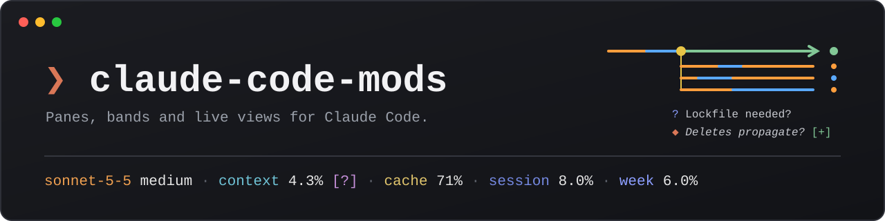
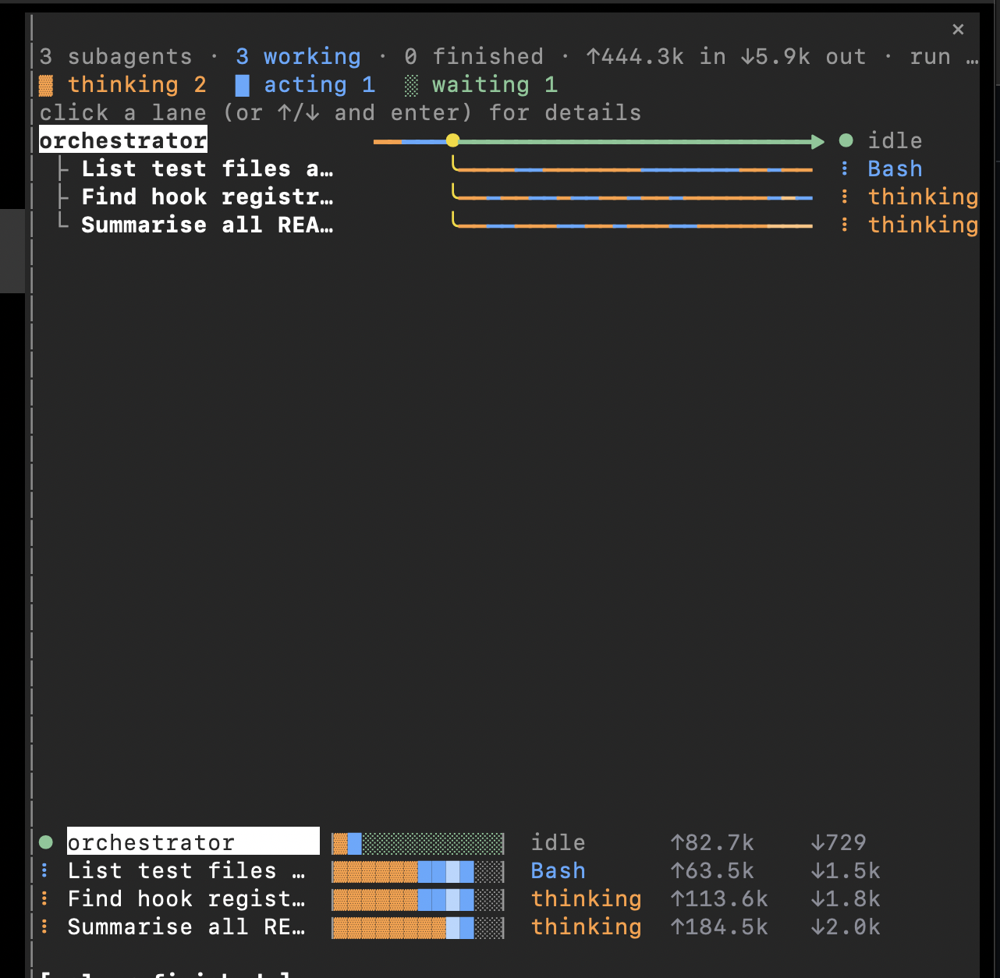
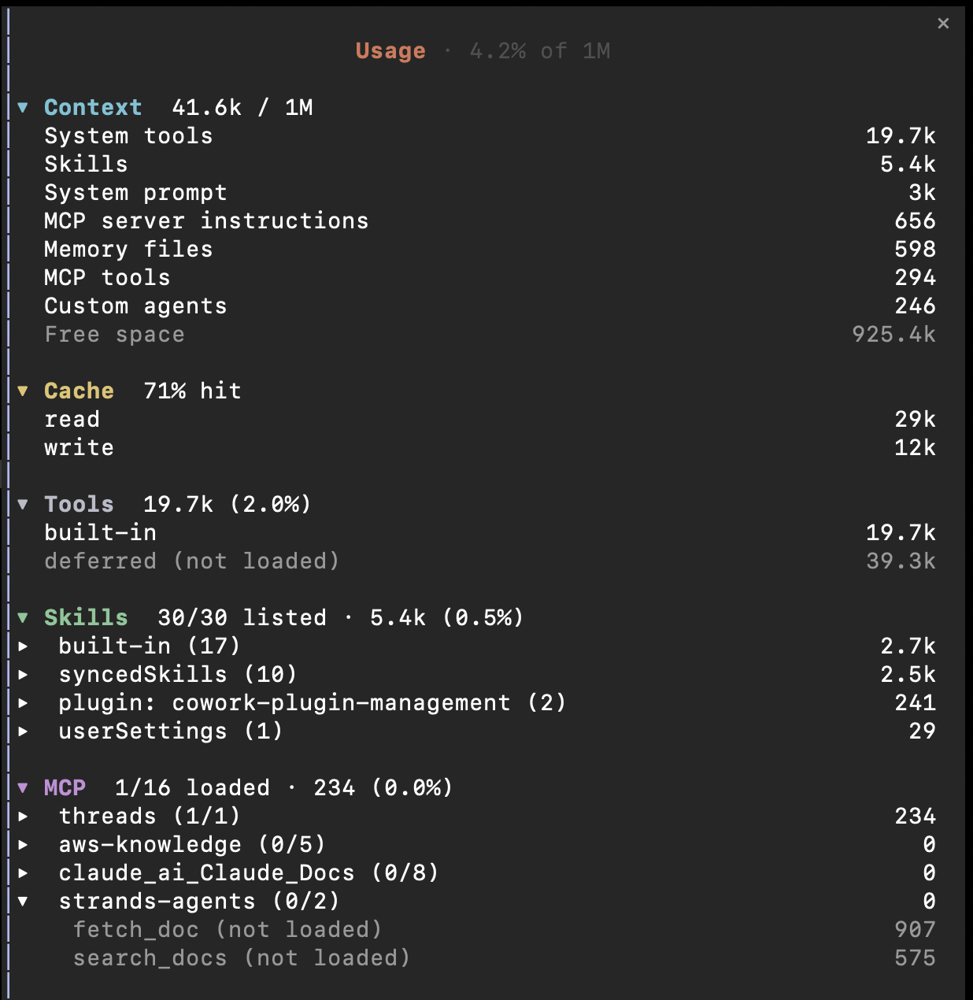
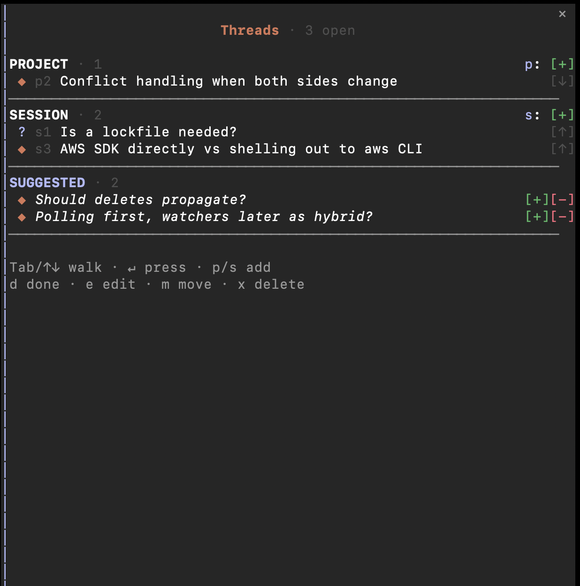

<p align="center">
  
</p>

<p align="center">
  <b>Open-source mods for <a href="https://claude.com/claude-code">Claude Code</a>.</b><br>
  See your subagents at work, keep your context and limits in view, and never lose an open question.
</p>

<p align="center">
  <a href="LICENSE.txt"></a>
  <a href="https://github.com/paulosergio-jnr/claude-code-mods/actions/workflows/check.yml"></a>
  <a href="https://claude.com/blog/claude-code-mods"></a>
</p>

<p align="center">
  <a href="#the-mods">The mods</a> · <a href="#install">Install</a> · <a href="#build-your-own">Build your own</a> · <a href="CONTRIBUTING.md">Contributing</a>
</p>

## The mods

<table>
  <tr>
    <td align="center" valign="top" width="33%">
      <a href="mods/agent-flow"></a><br>
      <b><a href="mods/agent-flow">agent-flow</a></b><br>
      <sub>Your subagents on a live timeline</sub>
    </td>
    <td align="center" valign="top" width="33%">
      <a href="mods/usage-band"></a><br>
      <b><a href="mods/usage-band">usage-band</a></b><br>
      <sub>Context, cache and limits above the prompt</sub>
    </td>
    <td align="center" valign="top" width="33%">
      <a href="mods/threads"></a><br>
      <b><a href="mods/threads">threads</a></b><br>
      <sub>Open questions that don't get lost</sub>
    </td>
  </tr>
</table>

| Mod | What it does | Shows up as | Open it with |
| --- | --- | --- | --- |
| 🛰️ [**agent-flow**](mods/agent-flow) | Animated timeline pane of the orchestrator and its subagents: who is thinking, acting or waiting, and the messages between them. | Side pane | `/agent-flow`, or by itself when a subagent spawns |
| 📊 [**usage-band**](mods/usage-band) | Band above the prompt showing the model and effort, context %, cache hit rate, and session and weekly limits, with a click-to-open side pane that breaks down context, cache, tools, skills and MCP. | Band above the prompt, side pane | Always on; click `[?]` for the pane |
| 🧵 [**threads**](mods/threads) | Side pane to track open questions, doubts and ideas as threads, per session or saved per project, with threads Claude suggests for you to accept or dismiss. | Side pane, slash commands | `/threads`, `/thread <text>` |

## Install

Inside Claude Code, add the marketplace once, then install the mods you want:

```text
/plugin marketplace add paulosergio-jnr/claude-code-mods
/plugin install usage-band@claude-code-mods
/reload-plugins
```

Swap `usage-band` for `agent-flow` or `threads`. Each mod's settings are in `/config`.

<details>
<summary><b>From the terminal, or from a clone</b></summary>

```sh
claude plugin marketplace add paulosergio-jnr/claude-code-mods
claude plugin install agent-flow@claude-code-mods
```

Or load a mod straight from a clone, for one session:

```sh
git clone https://github.com/paulosergio-jnr/claude-code-mods
claude --plugin-dir ./claude-code-mods/mods/threads
```

</details>

> [!NOTE]
> Mods (function hooks) are an early-access part of Claude Code, and their API can change between releases. If a mod stops working after an update, look for a dim line starting with its name in the transcript, and [open an issue](https://github.com/paulosergio-jnr/claude-code-mods/issues) with it.

## Build your own

A mod is a Claude Code plugin made of *function hooks*: a TypeScript module that can draw panes and bands, set the status line, show toasts, add slash commands, and block, rewrite or react to tool calls and prompts.

```sh
scripts/new-mod.sh my-mod "One line on what it does"   # scaffold it and list it in the marketplace
claude --plugin-dir mods/my-mod                          # try it live; edits reload each turn
scripts/check.sh my-mod                                  # validate and run its tests
```

The full workflow is in [CONTRIBUTING.md](CONTRIBUTING.md).

<details>
<summary><b>Repository layout</b></summary>

```text
.claude-plugin/marketplace.json   the marketplace: one entry per mod
mods/<name>/
  .claude-plugin/plugin.json      the mod's manifest
  hooks/hooks.json                { "modules": ["./register.ts"] }
  hooks/register.ts(x)            the hooks module
  types/index.d.ts                the $.state contract (only if the mod keeps state)
  **/*.test.ts                    run by `claude plugin test`
  README.md
docs/                             screenshots and the banner
scripts/new-mod.sh                scaffold a mod and list it in the marketplace
scripts/check.sh                  validate the marketplace and every mod, run their tests
```

</details>

## License

[Apache 2.0](LICENSE.txt)
