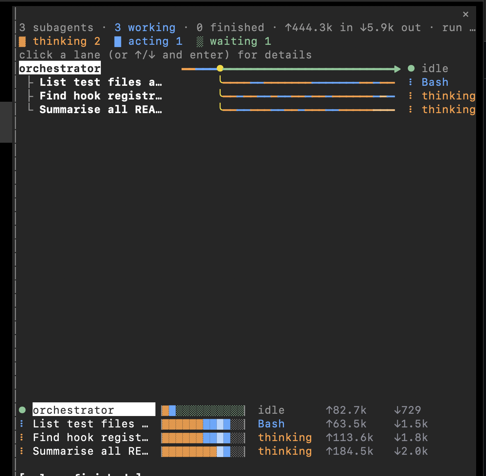

# 🛰️ agent-flow

**Watch the orchestrator and its subagents work, live.** An animated pane shows who is thinking, acting or waiting, and the messages passed between them.

<p align="center">
  
</p>

<p align="center">
  <a href="#install">Install</a> · <a href="#what-you-see">What you see</a> · <a href="#use">Use</a> · <a href="#settings">Settings</a> · <a href="../../README.md">All mods</a>
</p>

## Install

Inside Claude Code:

```text
/plugin marketplace add paulosergio-jnr/claude-code-mods
/plugin install agent-flow@claude-code-mods
/reload-plugins
/agent-flow
```

## What you see

| Part | Shows |
| --- | --- |
| **Timeline** | One line per agent, every agent always listed: its name on the left, the tool or state on the right. The time axis is the run itself, from its first activity to its last event, fitted to the pane width, so it redraws when something happens rather than scrolling with the clock. |
| **Colours** | 🟧 orange thinking, 🟦 blue acting (running a tool), 🟩 green waiting (idle, or for its subagents). |
| **Messages** | A `●` drops from a parent to where a subagent starts (`╰`), and the result climbs back (`╯`, `◆`) where it ends. Spinners, packets and the shimmer on running agents keep moving between events. |
| **Summary rows** | One compact row per agent at the foot of the pane: badge and name, a bar of how long it ran against the whole run (filled part coloured by its thinking, acting and waiting time, the rest dotted), its tool or `done 12s`, and its tokens in and out (`↑12k` `↓2k`). |
| **Details** | Click a lane or a row, or use ↑/↓ and Enter, to open a strip with the agent's type, model, tokens, cache hit rate, tool counts, skills, task and result. It sits between the timeline and the summary rows, and shows only while an agent is selected. |

## Use

- `/agent-flow` opens the pane at any time.
- **clear finished** removes finished subagents and the interactions drawn between them.

**Where it runs:** terminal and desktop get the animated view (below 80 columns the timeline narrows to a short bar per lane); VS Code and mobile get a plain list.

## Settings

Change them in `/config`, or with `claude plugin configure agent-flow@claude-code-mods`.

| Setting | Values | Default |
| --- | --- | --- |
| `autoOpen` | `never`: only `/agent-flow` opens the pane.<br>`on-subagent`: it also opens when a subagent spawns.<br>`always`: it also opens when a session starts. | `on-subagent` |

> [!TIP]
> A pane opened automatically needs a terminal at least 144 columns wide. One opened with `/agent-flow` fits any width.
