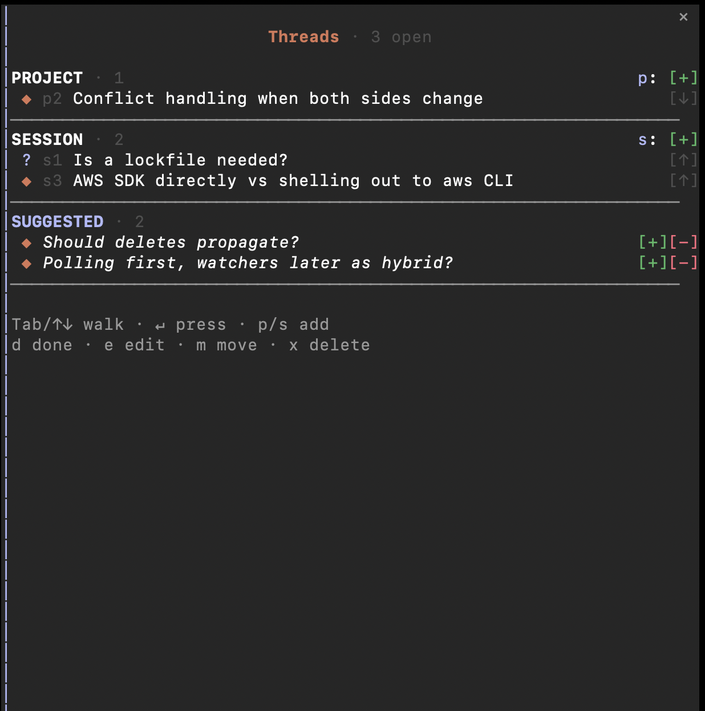

# 🧵 threads

**Keep the open questions, doubts and ideas that get lost in a long conversation.** A side pane with your **Project** and **Session** threads, plus the ones Claude suggests for you to accept or dismiss.

<p align="center">
  
</p>

<p align="center">
  <a href="#install">Install</a> · <a href="#how-it-works">How it works</a> · <a href="#use">Use</a> · <a href="#settings">Settings</a> · <a href="#notes">Notes</a> · <a href="../../README.md">All mods</a>
</p>

## Install

Inside Claude Code:

```text
/plugin marketplace add paulosergio-jnr/claude-code-mods
/plugin install threads@claude-code-mods
/reload-plugins
/threads
```

## How it works

| List | Holds | Kept |
| --- | --- | --- |
| **Project** | Threads that belong to the repository | In `.claude/threads.local.json` |
| **Session** | Threads that belong to one conversation | Come back with `claude --resume`; gone on `/clear` |
| **Suggested** | Threads Claude sees left open, waiting for you | Until you accept `[+]` or dismiss `[-]` them, or empty the list with `[ clear all suggestions ]`, under the last one |

A thread has a title, an optional note and an optional kind: `?` question, `!` doubt, `◇` explore, `◆` decision.

## Use

| Command or key | Does |
| --- | --- |
| `/threads` | Shows or hides the pane |
| `/thread <text>` | Adds a session thread from the prompt |
| `/thread --project <text>` | Adds a project thread |
| `[↑]` / `[↓]` | Promotes a session thread to the project, or demotes a project one |
| `[ done ]` `[ edit ]` `[ to project ]` `[ delete ]` | Buttons under the selected row, which is highlighted in whole. Keys `d` · `e` · `m` · `x` press them |
| `p` · `s` | Adds a project or a session thread |
| Tab, ↑/↓ | Walk the rows and buttons; clicking works too |

## Settings

Change them in `/config`, or with `claude plugin configure threads@claude-code-mods`.

| Setting | Values | Default |
| --- | --- | --- |
| `suggestions` | `on`, `off`. `off` registers no tool. | `on` |
| `paneVisibility` | `at-start`, `at-suggestion` (once per session), `manual` | `manual` |
| `doneRetention` | `keep`, or `delete` 30 seconds after finishing, with an Undo | `keep` |

## Notes

- Session threads are saved in the plugin's store (under your Claude Code config directory) as they change, keyed by session id, and dropped after 30 days unused. Suggestions are not saved.
- The project file is plain JSON. Commit it or add `.claude/threads.local.json` to `.gitignore`, as you prefer.
- Sessions sharing a project coordinate writes with a lock directory, `.claude/threads.local.lock`, and the pane picks up each other's changes within a couple of seconds.
- Suggestions come from the `suggest_threads` tool Claude can call: at most 5 per turn, 10 waiting at a time, and never a title that is already a thread.
- When to suggest is explained to Claude only in the tool's own description, so it reads the same on every machine, including Team, Enterprise or managed ones where `cc-plugin-sec-default` skips user plugins' system prompt hooks. Claude may call it at any point in a turn, whenever it notices something left open.
