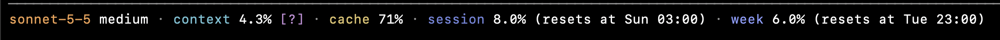
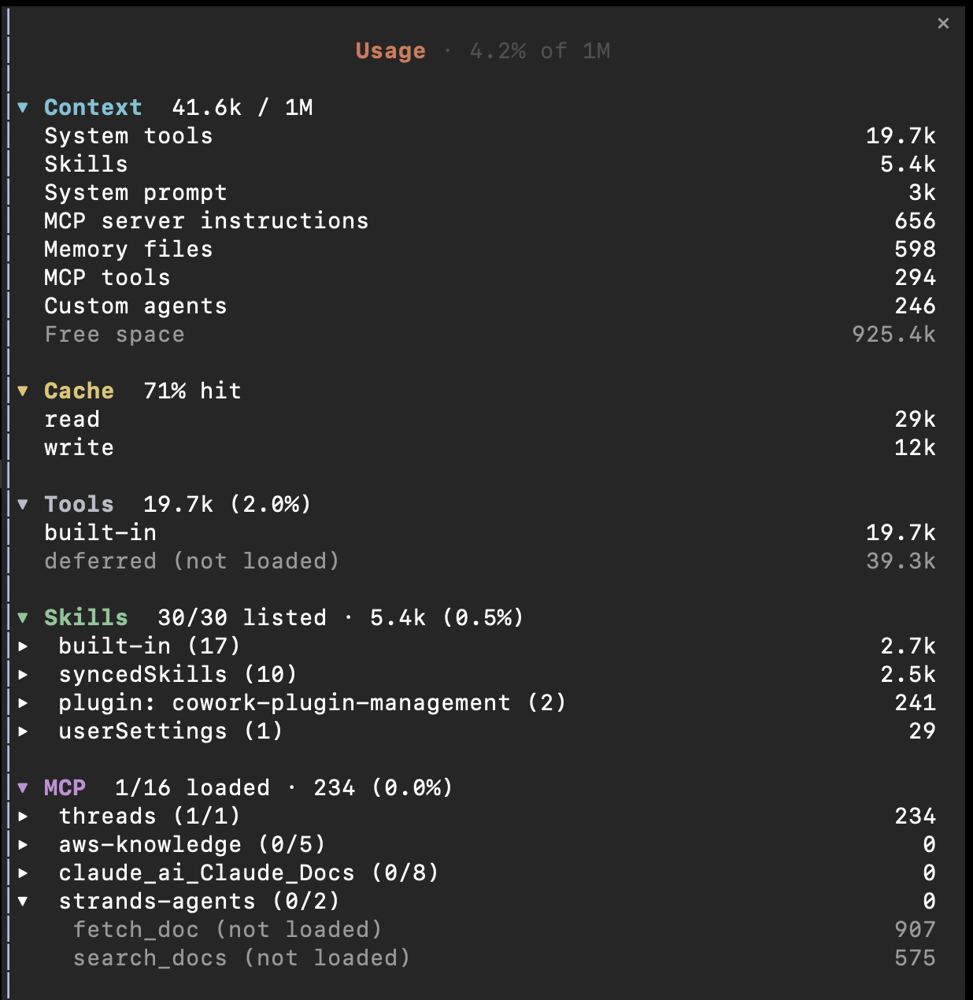

# usage-band

```
/plugin install usage-band --marketplace paulosergio-jnr/claude-code-mods
```

A dim band above the prompt. Click the `[?]` after `context` to open a side pane with the full breakdown, and click it again to close the pane. The sign is purple, dimmed while the pane is closed.

Band:



Pane, with every section open and one MCP server opened:



The pane has a section for each of these. All start folded except Context, and a click on a heading opens or folds it. Opening Skills or MCP shows its groups (a source, a plugin or a server), each folded too, so a second click opens one:

- **Context:** tokens by category, with the free space.
- **Cache:** the hit rate, and the tokens read from and written to the cache.
- **Tools:** the built-in tools' schema tokens, and the deferred ones that are not in the window.
- **Skills:** how many are listed out of the total, grouped by source or plugin, largest first.
- **MCP:** loaded out of total tools, grouped by server, largest first; tools not in the window are dim.

- The model (orange) and effort (white) lead the band once the first request names them; the effort is left out on a model without one.
- `cache` is the share of the last response's input read from the prompt cache; the pane adds the cache read and write token counts. It is absent before the first response, and drops after a cache break such as `/model` or a long pause.
- `context`, `session` and `week` turn yellow from 75.0% and red from 90.0%.
- `tools`, `skills` and `mcp` are in the pane only, with their count and share of the context window and what is in them. Tool schema tokens are counted as `/context` counts them; the rest is the engine's local estimate (`/context` may differ slightly).
- `session` is the five-hour rate-limit window and `week` the seven-day one; both only appear on a subscription.
- `cache`, `session` and `week` can be switched off with their `show*` options, and `tools`, `skills` and `mcp` with `showTools`, `showSkills` and `showMcp`, which hide their pane sections. `context` stays.
- The toggle is a click and the pane is a side pane, so it works where those do: the terminal and desktop surfaces.
