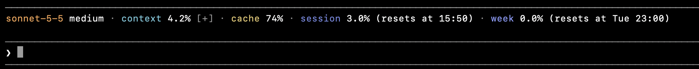
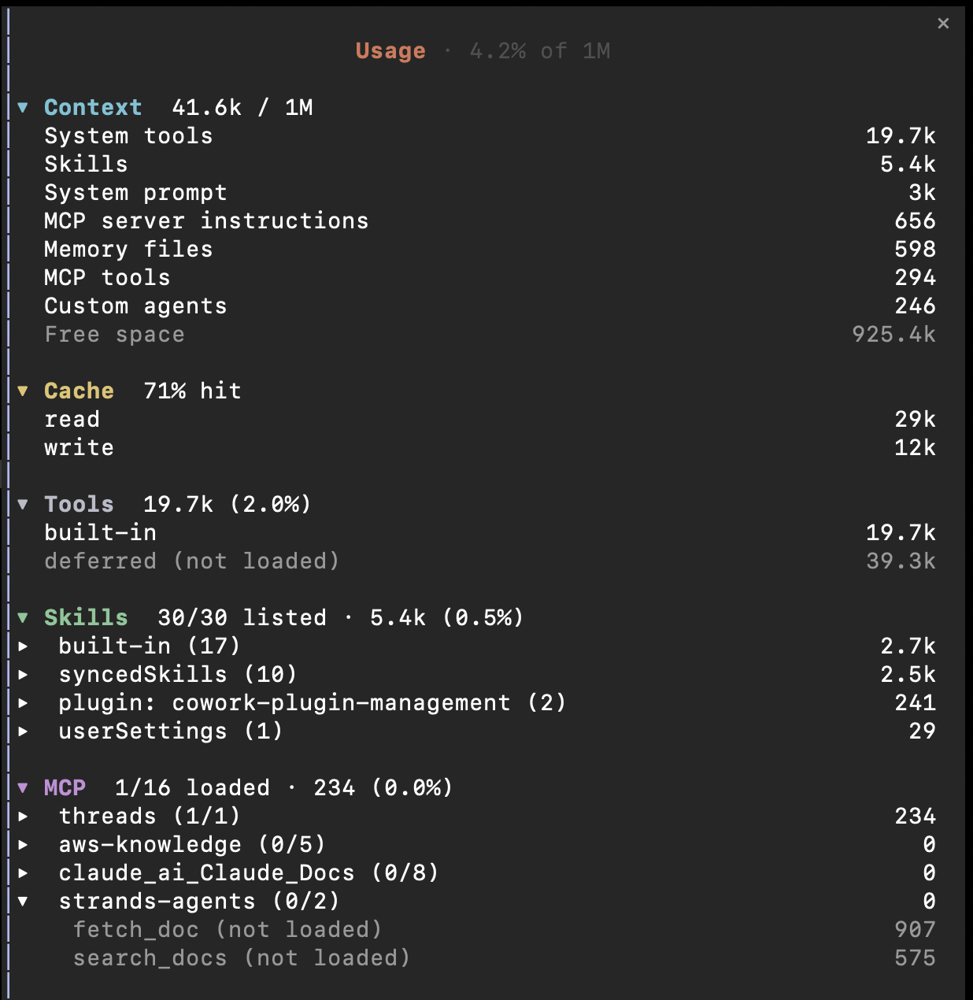

# 📊 usage-band

**Your model, context, cache and limits, always in view.** A dim band above the prompt, with a side pane one click away that breaks the context window down.

<p align="center">
  
</p>

<p align="center">
  <a href="#install">Install</a> · <a href="#the-band">The band</a> · <a href="#the-pane">The pane</a> · <a href="#settings">Settings</a> · <a href="../../README.md">All mods</a>
</p>

## Install

Inside Claude Code:

```text
/plugin marketplace add paulosergio-jnr/claude-code-mods
/plugin install usage-band@claude-code-mods
/reload-plugins
```

The band appears above the prompt straight away.

## The band

| Segment | Shows |
| --- | --- |
| **model** and **effort** | The main loop's model (orange) and effort (white), once the first request names them. The effort is left out on a model without one. |
| **context** | How full the context window is. Click the purple `[?]` after it to open the pane, and again to close it; the sign is bold while the pane is open. |
| **cache** | The share of the last response's input read from the prompt cache. Absent before the first response; it drops after a cache break such as `/model` or a long pause. |
| **session** and **week** | The five-hour and seven-day rate-limit windows, with when each resets. Only on a subscription. |

`context`, `session` and `week` turn yellow from 75.0% and red from 90.0%.

## The pane

<p align="center">
  
</p>

Every section starts folded except Context; click a heading to open or fold it. Skills and MCP open onto their groups (a source, a plugin or a server), each folded too, so a second click opens one.

| Section | Shows |
| --- | --- |
| **Context** | Tokens by category, with the free space. |
| **Cache** | The hit rate, and the tokens read from and written to the cache. |
| **Tools** | The built-in tools' schema tokens, and the deferred ones that are not in the window. |
| **Skills** | How many are listed out of the total, grouped by source or plugin, largest first. |
| **MCP** | Loaded out of total tools, grouped by server, largest first; tools not in the window are dim. |

Tool schema tokens are counted as `/context` counts them; the rest is the engine's local estimate, so `/context` may differ slightly.

## Settings

Change them in `/config`, or with `claude plugin configure usage-band@claude-code-mods`. Everything is on by default; `context` always stays.

| Setting | Hides |
| --- | --- |
| `showCache` | `cache` on the band, and the Cache section of the pane |
| `showSession` | the five-hour window |
| `showWeek` | the seven-day window |
| `showTools` | the Tools section of the pane |
| `showSkills` | the Skills section of the pane |
| `showMcp` | the MCP section of the pane |

## Notes

- The toggle is a click and the pane is a side pane, so they work where those do: the terminal and desktop surfaces.
- Under `claude --agent <name>`, Skills and MCP count only what that agent can use. An agent whose `tools:` list leaves out `Skill` or its `mcp__…` servers shows none there, as `/context` does.
